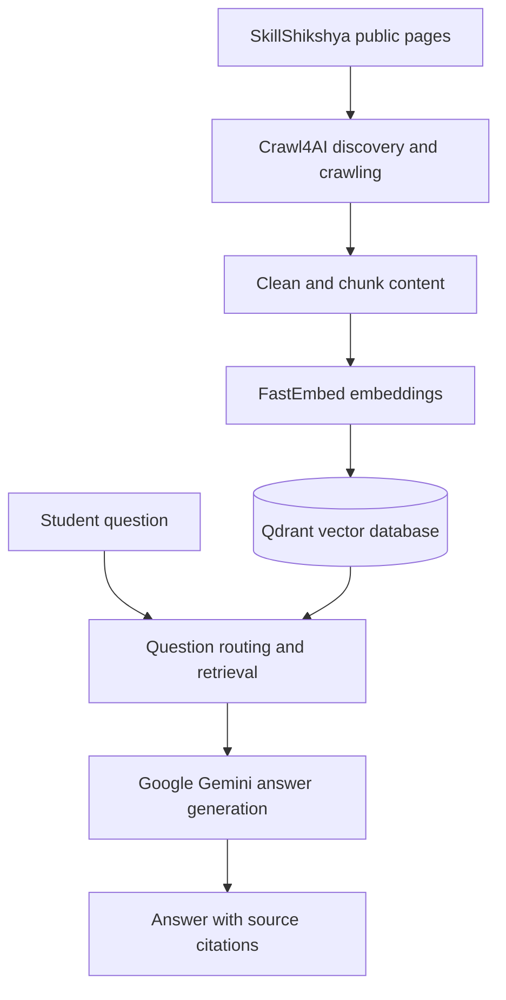
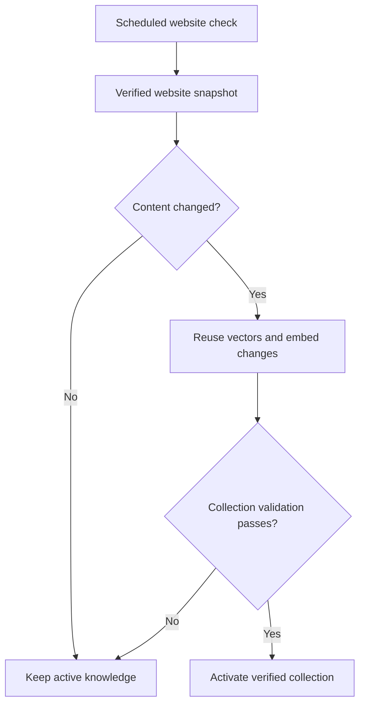

# SkillSathi AI | SkillShikshya Guide

<div align="center">

### Your bilingual AI companion for skills, courses and career exploration

An AI-powered, website-grounded chatbot helping learners explore **SkillShikshya** courses, practical skills, career paths and training opportunities in **English, नेपाली and Romanized Nepali**.

[](https://www.python.org/)
[](https://fastapi.tiangolo.com/)
[](https://qdrant.tech/)
[](https://ai.google.dev/)
[](#verification--project-status)

[Explore Features](#-features) · [Quick Start](#-quick-start) · [Architecture](#-how-it-works) · [Sync Workflow](#-automatic-knowledge-synchronization) · [Testing](#-testing)

**[SkillShikshya Website](https://skillshikshya.com)**

</div>

---

## ✨ Features

| Capability | What it does |
| --- | --- |
| 🌐 Bilingual conversations | Understands English, Nepali and Romanized Nepali questions |
| 📚 Website-grounded answers | Uses indexed SkillShikshya website content as evidence |
| 🎓 Course discovery | Explains available courses and relevant details |
| ⚖️ Course comparisons | Compares relevant training programs |
| 🧭 Career guidance | Helps explore skills, learning routes and career opportunities |
| 💬 Multiple questions | Handles more than one question per message |
| 🔗 Source citations | Links back to supporting SkillShikshya pages |
| 🔄 Automatic syncing | Checks for website changes on a schedule |
| 🧩 Incremental indexing | Reuses unchanged vectors and embeds changed content |
| ✅ Safe activation | Validates a new knowledge collection before switching to it |
| 🖥️ Web chat | Includes a SkillShikshya-themed HTML, CSS and JavaScript interface |

## 🚀 Quick Start

**Requirements:** Python 3.12+, [uv](https://docs.astral.sh/uv/), Git, a Google Gemini API key, and Crawl4AI browser dependencies.

<details open>
<summary><strong>1. Clone and install</strong></summary>

```bash
git clone https://github.com/<YOUR_USERNAME>/skillsathi-ai.git
cd skillsathi-ai
uv sync
```

Replace `<YOUR_USERNAME>` with the GitHub account or organisation that hosts this repository.

</details>

<details open>
<summary><strong>2. Configure the environment</strong></summary>

```bash
cp .env.example .env
```

Edit `.env` and set `GEMINI_API_KEY`. Never commit `.env` or disclose your API key.

| Variable | Purpose |
| --- | --- |
| `GEMINI_API_KEY` | Gemini API credential |
| `GEMINI_MODEL` | Optional model configuration |
| `SKILLSHIKSHYA_AUTO_SYNC_ENABLED` | Enables or disables scheduled refreshes |
| `SKILLSHIKSHYA_AUTO_SYNC_INTERVAL_HOURS` | Refresh interval in hours |

</details>

<details open>
<summary><strong>3. Bootstrap the knowledge database (fresh installations only)</strong></summary>

Make sure the server is stopped and the knowledge database has not been initialized.

```bash
uv run python -m app.ingestion.bootstrap
```

Bootstrap discovers eligible public pages, crawls and verifies content, generates embeddings, creates and verifies a Qdrant collection, activates the `skillshikshya_active` alias, and records an activation receipt.

> [!CAUTION]
> Run bootstrap **only on a fresh installation with an empty knowledge database**. The command is designed to refuse to overwrite an initialized database.

</details>

<details open>
<summary><strong>4. Start the chat server</strong></summary>

```bash
uv run uvicorn app.api.server:app \
  --host 127.0.0.1 \
  --port 8000 \
  --workers 1
```

Open **http://127.0.0.1:8000**.

</details>

<details>
<summary><strong>Optional: Start with automatic synchronization</strong></summary>

```bash
SKILLSHIKSHYA_AUTO_SYNC_ENABLED=1 \
SKILLSHIKSHYA_AUTO_SYNC_INTERVAL_HOURS=6 \
uv run uvicorn app.api.server:app \
  --host 127.0.0.1 \
  --port 8000 \
  --workers 1
```

The scheduler runs **only while the server is running**. Local embedded Qdrant should be accessed by **one server worker**.

</details>

## 🧠 How It Works

SkillSathi AI uses **Retrieval-Augmented Generation (RAG)** to answer questions using source material retrieved from SkillShikshya, rather than relying on the language model's memory alone.



**Pipeline:** Website discovery → crawling → cleaning and chunking → embeddings → Qdrant storage → retrieval → Gemini response → source citations.

## 🔄 Automatic Knowledge Synchronization

Scheduled refreshes discover and verify eligible pages, detect changed content, reuse vectors for unchanged content, embed changes, validate the new collection, and then activate it.



> [!IMPORTANT]
> If a refresh fails before activation, the workflow is designed to preserve the previously active knowledge collection.

## 🧰 Technology Stack

| Layer | Technology |
| --- | --- |
| Language | Python 3.12+ |
| API backend | FastAPI |
| Frontend | HTML, CSS, JavaScript |
| Website crawling | Crawl4AI |
| Embeddings | FastEmbed with `BAAI/bge-small-en-v1.5` |
| Vector storage | Qdrant |
| Answer generation | Google Gemini |
| Dependencies | uv |
| Tests | Python `unittest` |

<details>
<summary><strong>📁 Explore project structure</strong></summary>

```text
skillsathi-ai/
├── app/
│   ├── agent/
│   │   ├── router.py
│   │   ├── executor.py
│   │   └── service.py
│   ├── api/
│   │   ├── server.py
│   │   ├── chat.html
│   │   └── widget.js
│   ├── ingestion/
│   │   ├── crawler.py
│   │   ├── auto_sync.py
│   │   ├── auto_sync_scheduler.py
│   │   ├── change_detection.py
│   │   └── vector_activation.py
│   └── rag/
│       └── engine.py
├── tests/
├── data/                  # Generated locally, not committed
├── pyproject.toml
├── uv.lock
├── .env.example
├── .gitignore
└── README.md
```

</details>

## 🧪 Testing

Run the full regression suite:

```bash
uv run python -m unittest discover -s tests -q
```

Coverage areas include question routing, RAG, crawling and ingestion, change detection, incremental activation, scheduling and multi-question handling.

## 📊 Verification & Project Status

The following checkpoints are **project-provided reports**, not independently rerun as part of preparing this README.

| Checkpoint | Reported result |
| --- | --- |
| October 31, 2026 clean-clone verification | **266 automated tests passed** |
| Fresh dependencies | `uv sync --frozen` succeeded |
| Live crawl | 38 approved public pages |
| Knowledge indexing | 38 verified pages, 857 vectors |
| Local Qdrant | Initial collection activated |
| URL controls | Unapproved URLs excluded from bootstrap |
| Earlier local checkpoint | **262 automated tests passed** |

Page and vector totals may change as the source website changes.

> [!NOTE]
> The supplied project notes also say bootstrap passed unit tests and an isolated integration test with a verified **40-page snapshot and synthetic embeddings**, while full live-crawl/real-embedding acceptance remained pending. That statement conflicts with the separate clean-clone verification claim above. **Confirm which checkpoint is the release-authoritative result before publishing final acceptance claims.**

### MVP status

**Implemented and locally tested:** website-grounded answers, bilingual questions, course discovery and comparison, multi-question routing, citations, scheduled synchronization, verified incremental activation and regression tests.

**Release checklist:**

- [ ] Reconcile clean-clone and bootstrap acceptance records
- [ ] Complete deployment and security review
- [ ] Publish repository to GitHub
- [ ] Confirm fresh-clone acceptance in the intended release environment

## 🔐 Security & Data Handling

The repository is intended to exclude secrets and generated local data, including `.env`, crawl snapshots, `data/`, Qdrant database files, virtual environments, caches and logs.

- Keep API keys in environment variables, not source files.
- Treat retrieved website content as **untrusted reference data**.
- Do not follow instructions embedded in retrieved pages.
- Restrict ingestion to approved public pages.

## ⚠️ Limitations

- Answers are limited by the indexed SkillShikshya sources; this is not unrestricted web search.
- Website marketing claims are not independent rankings or endorsements.
- Information can become stale between refreshes.
- New installations require initial knowledge bootstrap.
- Scheduled syncing stops when its server process stops.
- Embedded local Qdrant is not suitable for concurrent multi-worker deployment.
- Public production hosting needs additional deployment and security validation.

## 👨‍💻 Developer

**Ganesh Pokharel**

**Project:** SkillSathi AI | SkillShikshya Guide  
**Website content source:** [skillshikshya.com](https://skillshikshya.com)

---

<div align="center">
  <sub>Built to make skill and career exploration easier with website-grounded AI.</sub>
  <p><a href="#skillsathi-ai--skillshikshya-guide">↑ Back to top</a></p>
</div>
