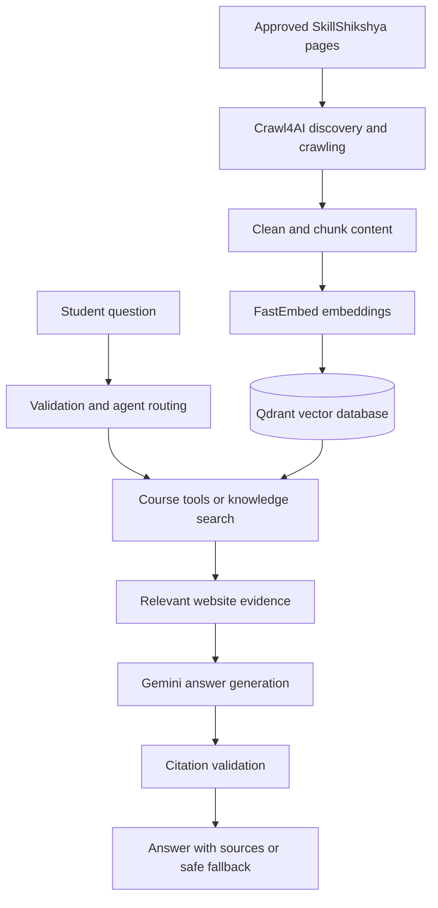
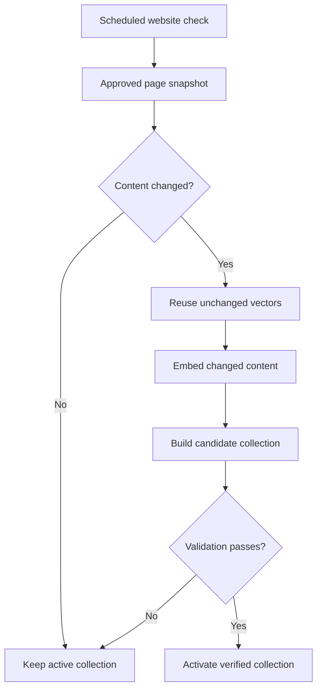

<div align="center">

# SkillSathi AI | SkillShikshya Guide

### A bilingual, website-grounded AI assistant for learning and career exploration

Ask about **SkillShikshya courses, skills, training and career options** in **English, नेपाली, or Romanized Nepali**. SkillSathi AI retrieves relevant website content and responds using source-grounded evidence.

[](https://www.python.org/)
[](https://fastapi.tiangolo.com/)
[](https://qdrant.tech/)
[](https://ai.google.dev/)
[](https://streamlit.io/)
[](#-testing--verification)

[Features](#-features) · [Quick Start](#-quick-start) · [Architecture](#-how-it-works) · [API](#-api--websocket) · [Testing](#-testing--verification)

**[SkillShikshya Website](https://skillshikshya.com/)** · **[Source Repository](https://github.com/GaneshPokharel-tech/skillsathi-ai)**

</div>

---

## ✨ Features

| Capability | Description |
| --- | --- |
| 🌐 English & Nepali | Accepts English, Nepali and Romanized Nepali questions; responses can be set to English or Nepali (Devanagari). |
| 📚 Website-grounded RAG | Uses retrieved SkillShikshya content rather than relying only on model memory. |
| 🧭 Multi-tool agent | Routes questions to course discovery, course details, comparison, knowledge search or clarification. |
| 🎓 Course exploration | Helps learners find courses and understand information available on the website. |
| 💬 Multi-question support | Handles supported messages containing several questions. |
| 🔗 Validated citations | Shows supporting website sources when a properly cited answer is available. |
| ⚡ REST & WebSocket | FastAPI `/chat` and `/ws/chat`, with browser-side HTTP fallback. |
| 🖥️ Web and Streamlit interfaces | Custom browser chatbot and a separate Streamlit demonstration. |
| 🔄 Knowledge synchronization | Optional scheduled content refresh with incremental indexing and validated collection activation. |
| 📲 WhatsApp contact | Opens a prefilled WhatsApp chat after a user click; the student sends the message manually. |
| 🧩 Embeddable widget | Serves a frontend widget through `/widget.js`. |

## 🚀 Quick Start

### Requirements

- Python **3.12+** and [uv](https://docs.astral.sh/uv/)
- Git
- A **Google Gemini API key**
- Crawl4AI browser dependencies (see its [installation guide](https://docs.crawl4ai.com/core/installation/))

### 1. Clone and install

```bash
git clone https://github.com/GaneshPokharel-tech/skillsathi-ai.git
cd skillsathi-ai
uv sync --frozen
```

> If the repository is still private, you need GitHub access to clone it.

### 2. Set up Crawl4AI

```bash
uv run crawl4ai-setup
```

If browser setup fails, follow the operating-system instructions in the Crawl4AI documentation.

### 3. Configure the environment

```bash
cp .env.example .env
```

Edit `.env` and provide your Gemini API key.

| Variable | Purpose |
| --- | --- |
| `GEMINI_API_KEY` | Gemini API credential for answer generation. |
| `GEMINI_MODEL` | Optional Gemini model setting. |
| `SKILLSHIKSHYA_AUTO_SYNC_ENABLED` | Whether to enable scheduled knowledge refreshes. |
| `SKILLSHIKSHYA_AUTO_SYNC_INTERVAL_HOURS` | Refresh interval in hours. |

**Never commit `.env` or API keys to Git.**

### 4. Bootstrap the knowledge database (fresh install only)

Stop the API server and ensure the local knowledge database has not been initialized. Then run:

```bash
uv run python -m app.ingestion.bootstrap
```

The bootstrap discovers approved pages, crawls and cleans content, creates embeddings, builds a Qdrant collection, validates it and activates the verified collection.

> [!CAUTION]
> Run bootstrap **only on a fresh installation with an uninitialized knowledge database**. It is not a command for resetting an existing working database.

### 5. Start FastAPI

```bash
SKILLSHIKSHYA_AUTO_SYNC_ENABLED=0 \
uv run uvicorn app.api.server:app \
  --host 127.0.0.1 \
  --port 8000 \
  --workers 1
```

Open **http://127.0.0.1:8000**.

**Important:** This project currently uses local embedded Qdrant. Keep the API at **one worker** and avoid opening the same Qdrant storage from another server process.

### 6. Run the Streamlit demo (optional)

Keep FastAPI running. In a **second terminal**:

```bash
uv run streamlit run app/demo/streamlit_app.py
```

Open the URL shown by Streamlit (normally **http://127.0.0.1:8501**). Streamlit calls the FastAPI backend; it does not independently open Qdrant.

### Optional: Start with automatic knowledge synchronization

```bash
SKILLSHIKSHYA_AUTO_SYNC_ENABLED=1 \
SKILLSHIKSHYA_AUTO_SYNC_INTERVAL_HOURS=6 \
uv run uvicorn app.api.server:app \
  --host 127.0.0.1 \
  --port 8000 \
  --workers 1
```

Scheduled refreshes operate **only while this server process is running**.

## 🧠 How It Works

SkillSathi AI implements **Retrieval-Augmented Generation (RAG)** to answer questions from indexed SkillShikshya website evidence.



**Pipeline:** Website → crawling → content processing → embeddings → Qdrant → agent tool selection → retrieval → Gemini → validated response.

### Agent tools

| Tool | Role |
| --- | --- |
| `list_courses` | Lists courses available in the indexed catalogue. |
| `get_course_details` | Returns details for one identified course. |
| `compare_courses` | Compares two identifiable courses. |
| `knowledge_search` | Retrieves supporting evidence for general website questions. |
| `clarify` | Requests clarification for ambiguous course requests. |

A greeting-only message can receive a deterministic local response without a Gemini call. For RAG responses, missing or invalid source citations are not silently fabricated; the system uses a safe fallback when a response contains no valid citation markers.

## 🔄 Automatic Knowledge Synchronization

Optional scheduled refreshes check approved public pages, detect changes and validate new knowledge before activation.



This process is designed to preserve the existing active collection if a refresh fails before activation. It does not continuously run when the API server is stopped.

## 🔌 API & WebSocket

| Method | Endpoint | Purpose |
| --- | --- | --- |
| `GET` | `/` | Serves the web chat interface. |
| `GET` | `/health` | Application health endpoint. |
| `POST` | `/chat` | Website-grounded chatbot API. |
| `WEBSOCKET` | `/ws/chat` | Persistent chat transport. |
| `GET` | `/widget.js` | Embeddable chatbot widget. |
| `GET` | `/brand-icon` | Brand icon resource. |

### REST example

```bash
curl -X POST http://127.0.0.1:8000/chat \
  -H "Content-Type: application/json" \
  -d '{
    "question": "What courses are available?",
    "language": "en",
    "top_k": 4
  }'
```

| Request field | Description |
| --- | --- |
| `question` | Required question, maximum 2,000 characters. |
| `language` | `en` or `ne`; default `ne`. |
| `top_k` | Integer from 1 to 10; default 4. |
| `pending_course_urls` | Optional course-selection context for supported follow-ups. |

Responses contain an answer and citation data when available. A model-generated answer lacking valid evidence markers gets a localized fallback rather than fabricated source references.

### Browser transport

- WebSocket: `ws://127.0.0.1:8000/ws/chat` for local use.
- REST fallback: `POST /chat`.
- For an HTTPS deployment, use `wss://` with a correctly configured reverse proxy.

## 📲 WhatsApp Contact

The browser chat includes **“WhatsApp मा सम्पर्क गर्नुहोस्”**.

- Destination: **+977 9868730959**.
- A click opens `wa.me` with a generic prefilled course/admission inquiry.
- The student reviews or edits the message and presses **Send** in WhatsApp.
- The app does **not** automatically send messages, collect a lead form or email student details.

## 🧰 Technology Stack

| Layer | Technology |
| --- | --- |
| Language | Python 3.12+ |
| Backend | FastAPI |
| Browser UI | HTML, CSS, JavaScript |
| Demo UI | Streamlit |
| WebSocket transport | FastAPI WebSocket |
| Crawling | Crawl4AI |
| Embeddings | FastEmbed / `BAAI/bge-small-en-v1.5` |
| Vector database | Qdrant (embedded local storage) |
| Answer generation | Google Gemini |
| Dependency management | uv |
| Tests | Python `unittest` |

<details>
<summary><strong>📁 Project Structure</strong></summary>

```text
skillsathi-ai/
├── app/
│   ├── agent/
│   │   ├── router.py
│   │   ├── executor.py
│   │   └── service.py
│   ├── api/
│   │   ├── server.py
│   │   ├── chat.html
│   │   └── widget.js
│   ├── demo/
│   │   └── streamlit_app.py
│   ├── ingestion/
│   │   ├── bootstrap.py
│   │   ├── crawler.py
│   │   ├── auto_sync.py
│   │   ├── auto_sync_scheduler.py
│   │   ├── change_detection.py
│   │   └── vector_activation.py
│   └── rag/
│       └── engine.py
├── tests/
├── data/                 # Local generated content; not tracked in Git
├── pyproject.toml
├── uv.lock
├── .env.example
├── .gitignore
└── README.md
```

</details>

## 🧪 Testing & Verification

Run the regression suite:

```bash
uv run python -m unittest discover -s tests -q
```

The latest **user-reported** run at commit `95cc164` passed **283 tests**. Test areas include routing, RAG, citations, crawling, indexing, scheduled synchronization, REST, WebSocket, Streamlit and the WhatsApp button.

| Checkpoint | Reported result |
| --- | --- |
| Full regression suite | **283 passed** |
| Latest WhatsApp commit | `95cc164` — pushed to `main` |
| Git working tree after push | Clean |
| Earlier fresh-clone website crawl | 38 approved pages |
| Earlier vector indexing | 857 indexed vectors, active collection verified |
| Git-tracked sensitive files audit | 0 paths flagged in the earlier audit |

> [!NOTE]
> These results were reported during development. The 38-page / 857-vector crawl checkpoint predates the latest WebSocket, Streamlit and WhatsApp commits. The latest revision has not been independently revalidated from a fresh clone for this README.

## 🔐 Security & Data Handling

- `.env`, generated crawl data and local Qdrant files should remain excluded from Git.
- Gemini credentials belong in environment variables, never in source code.
- The ingestion scope is limited to configured approved SkillShikshya pages.
- Retrieved website text is untrusted reference material, not executable instructions.
- API exception logging is designed to record exception types rather than student questions.
- WhatsApp requires an explicit click and a separate user action to send the prefilled message.

> [!WARNING]
> **Do not enter passwords, government IDs, payment details or other sensitive personal information into chat.** Comprehensive PII detection/redaction is **not currently implemented**. User messages may be included in the Gemini prompt sent to the external API.

A **public GitHub repository is not the same as a production-ready public API**. Before internet deployment, review HTTPS, rate limiting, authentication as appropriate, abuse prevention, privacy, logging, dependency security and secret handling. Inspect the full Git history for accidentally committed secrets before changing repository visibility.

## ⚠️ Known Limitations

- Answers are limited to indexed SkillShikshya information and may be incomplete or outdated.
- The website scope is configured for **SkillShikshya**, not arbitrary user-submitted URLs.
- There is no explicit hard Gemini output-token limit in the inspected implementation.
- Comprehensive server-side PII redaction is not implemented.
- Embedded local Qdrant uses single-process access; it is not a multi-worker deployment architecture.
- Initial bootstrap is required for a new knowledge database.
- Scheduled synchronization operates only while the server runs.
- Browser-based WhatsApp click-to-chat should be tested on actual desktop/mobile devices before claiming end-to-end verification.

## 📄 License

Check whether the repository contains a `LICENSE` file. If you want others to reuse or distribute this code, choose and add an explicit license. Publishing a repository publicly does not itself grant reuse rights.

## 👨‍💻 Developer

**Ganesh Pokharel**  
**Project:** SkillSathi AI | SkillShikshya Guide  
**Website content source:** [skillshikshya.com](https://skillshikshya.com)  
**Repository:** [GaneshPokharel-tech/skillsathi-ai](https://github.com/GaneshPokharel-tech/skillsathi-ai)

---

<div align="center">
  <sub>Built to make skill and career exploration easier with website-grounded AI.</sub>
  <p><a href="#skillsathi-ai--skillshikshya-guide">↑ Back to top</a></p>
</div>
